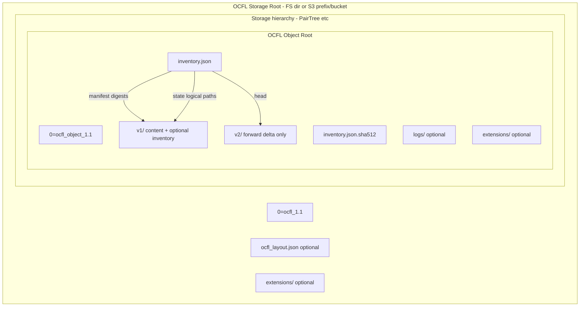

# Oxford Common File Layout (OCFL) 1.1

**Purpose:** Synthesized reference for AI agents implementing OCFL-compliant storage in ATPix (local filesystem **and** S3-compatible object stores). Covers object layout, inventory schema, digests, storage roots, path safety, versioning rules, and S3-specific constraints. For verbatim normative text, inventory JSON Schema, validation codes, or Implementation Notes, load `docs/references/OxfordCommonFileLayout_v1.1.pdf` or https://ocfl.io/1.1/spec/ via Progressive Disclosure. Object-in-motion guidance lives in [OCFL Implementation Notes](https://ocfl.io/1.1/implementation-notes).

**TL;DR:** OCFL defines how to store **versioned digital objects** as plain files/objects under a predictable hierarchy so repositories can be **rebuilt from the storage root alone**. Each object has a NAMASTE declaration, forward-delta **version directories**, and a UTF-8 JSON **inventory** + digest sidecar. Content is addressed by **digests** (prefer `sha512`), not by filename. The same layout maps to hierarchical filesystems **and** cloud object stores (S3 “buckets” as independent storage roots).

---

## Novice Mental Model

| Everyday idea | OCFL equivalent |
|---------------|-----------------|
| A preservation package (photo + metadata + history) | **OCFL Object** — URI-identified group of files + admin info |
| The folder for one package | **OCFL Object Root** — contains `0=ocfl_object_1.1`, inventory, versions |
| The whole repository volume / bucket | **OCFL Storage Root** — contains `0=ocfl_1.1` + object hierarchy |
| “What files exist in version 2?” | **Logical state** — map of digests → logical paths in `versions.vN.state` |
| Where bytes actually live on disk/S3 | **Content path** — relative to object root (e.g. `v1/content/file.txt`) |
| User-facing path in the package tree | **Logical path** — e.g. `foo/bar.xml` (not necessarily same as content path) |
| Catalog of all bitstreams | **Manifest** — digest → array of content paths |
| Proof inventory was not tampered | **Inventory digest sidecar** — `inventory.json.sha512` |
| New revision without rewriting old files | **Forward delta** — only new/changed bytes in new version dirs |
| Optional audit trail outside content | **logs/** directory |
| Optional non-normative features | **extensions/** (registered or documented locally) |

**Key insight:** Logical path ≠ content path. Digests bind them. Unchanged files across versions share one content path (de-dupe). Version directories are **immutable** once written; only append new versions.

---

## Design Goals (Source: Introduction)

1. **Completeness** — object carries content + metadata needed to rebuild without original app software.
2. **Parsability** — humans and simple tools can read layout + inventory without the original repository stack.
3. **Versioning** — forward-delta history (Moab-inspired); recreate any past logical state.
4. **Robustness** — digests for fixity; structure resists silent corruption and migration errors.
5. **Storage diversity** — hierarchical FS **and** object stores (namespaces/containers/keys).

Normative scope is **object-at-rest** + storage-root arrangement. **Object-in-motion** (write protocols, concurrency) is in Implementation Notes, not this PDF body. (Source: Introduction Note)

---

## Architecture Stack



### Core components (Source: §2 Terminology, §3, §4)

| Component | Role | Identifier / name |
|-----------|------|-------------------|
| **OCFL Storage Root** | Base of a layout; independent volume/bucket | NAMASTE `0=ocfl_1.1` |
| **OCFL Object** | Coherent digital entity + history | Unique `id` (SHOULD be URI) |
| **OCFL Object Root** | Base directory of one object | NAMASTE `0=ocfl_object_1.1` |
| **Version directory** | One version’s stored deltas | `v1`, `v2`, … (or zero-padded form) |
| **Content directory** | Preserved bitstreams for a version | Default `content`; or `contentDirectory` |
| **Inventory** | JSON history + manifest + states | `inventory.json` |
| **Inventory digest** | Sidecar integrity for inventory | `inventory.json.{algorithm}` |
| **Manifest** | Content-addressable index of bitstreams | Inventory key `manifest` |
| **Logical state** | User-visible tree at a version | Per-version `state` block |
| **Logs directory** | Out-of-band action records | Object root `logs/` |
| **Extensions** | Non-normative add-ons | `extensions/{name}/` |

---

## Key Constraints (MUST / MUST NOT)

### Object root structure (Source: §3.1–3.3)

- Object root MUST contain only: NAMASTE declaration, root inventory + digest, version directories, optional `logs/`, optional `extensions/`. (Source: §3.1)
- Exactly one object NAMASTE file: filename `0=ocfl_object_1.1`, contents `ocfl_object_1.1\n`. (Source: §3.2, [NAMASTE])
- Versions MUST be `v` + positive integers starting at **1**, continuous, no gaps. (Source: §3.3)
- Prefer non-padded names (`v1`, `v2`). Zero-padding MAY be used only if names start with `v0…` and padding length is consistent for the whole object. First version locks the convention. (Source: §3.3)
- Version directory children: inventory + digest only as files; SHOULD only have the designated content subdir otherwise. Once created, version dirs are **expected immutable**. (Source: §3.3)
- If a version has files, it MUST have the content subdir; if not, SHOULD NOT have it. (Source: §3.3.1)
- `contentDirectory` (if set): set in first version only, never change; MUST be a single path segment (no `/`, not `.` or `..`). Default name: `content`. (Source: §3.3.1)
- Every file under content MUST appear in that version’s inventory **manifest**. No empty directories under content (use e.g. `.keep` if needed). (Source: §3.3.1)
- Validators MUST ignore sibling dirs in the version directory other than the designated content directory. (Source: §3.3.1)

### Digests (Source: §3.4)

| Algorithm | Role | Encoding notes |
|-----------|------|----------------|
| **sha512** | **SHOULD** for content-addressing (default choice) | Hex (base16), full length |
| **sha256** | MAY for content-addressing | Hex, non-truncated |
| md5, sha1 | Fixity/legacy only (insecure) | Hex |
| blake2b-512 | Optional fixity | Hex, 2B variant 64-bit |

- Content-addressing MUST use `sha512` or `sha256`; SHOULD use `sha512`. (Source: §3.4)
- Clients MUST support all algorithms in the controlled vocabulary table; MAY ignore unsupported optional fixity algorithms. (Source: §3.4)
- Digests are case-insensitive in practice; inventories/JSON are case-sensitive keys — each digest MUST appear once in manifest/fixity regardless of case; compare digests case-insensitively. (Source: §3.4 note, §3.5.2, §3.5.4)

### Inventory (Source: §3.5–3.7)

- MUST be UTF-8 JSON [RFC8259], named `inventory.json`. No unknown keys. Key/array order insignificant. (Source: §3.5)
- Paths in inventory MUST use `/` only. (Source: §3.5)
- Required top-level keys: `id`, `type`, `digestAlgorithm`, `head`, `manifest`, `versions`. Optional: `contentDirectory`, `fixity`. (Source: §3.5.1)
- `id`: unique in local context; MUST NOT change across versions; SHOULD be a URI (not necessarily resolvable; URN OK). (Source: §3.5.1)
- `type` in object-root inventory MUST be `https://ocfl.io/1.1/spec/#inventory` for this version. (Source: §3.5.1)
- `head` MUST be the highest version directory name. (Source: §3.5.1)
- Manifest: digest → array of **content paths** relative to object root; digests used in any version state MUST appear. (Source: §3.5.2)
- Content path safety: elements not `.`, `..`, empty; no leading/trailing `/`; paths unique and non-conflicting (no path is prefix of another). (Source: §3.5.2)
- Versions block keys = version directory names; each version MUST have `created` (RFC3339 with timezone/`Z`, second granularity) and `state`. SHOULD have `message` and `user` (`name` required if `user` present; `address` SHOULD be mailto URI or personal URL). (Source: §3.5.3.1)
- Logical path safety: same rules as content paths; unique/non-conflicting within a version. State digests MUST match manifest digests exactly. (Source: §3.5.3.1)
- Fixity block optional; same shape as manifest; MAY cover any subset; need not carry forward to later versions. (Source: §3.5.4)
- Every inventory MUST have sidecar `inventory.json.{digestAlgorithm}` with body: `DIGEST inventory.json` (spaces/tabs between). Write digest **last** after inventory finalized. (Source: §3.6)
- Object root MUST have current inventory; each version directory SHOULD have inventory for versions up to that version. Root inventory MUST equal head version’s inventory when version inventories exist. Prior version blocks MUST match logical state of current inventory; `created`/`message`/`user` SHOULD match. (Source: §3.7)
- Version directories MUST conform to same or later OCFL spec than previous. (Source: §3.7.1)

### Logs & extensions (Source: §3.8–3.9, §4.4–4.5)

- Object MAY have `logs/` (format out of scope). (Source: §3.8)
- `extensions/` MUST contain only extension subdirectories; SHOULD use registered names. Local extensions MAY be documented as plain text in the storage root. (Source: §3.9, §4.5)

### Storage root (Source: §4)

- Exactly one root NAMASTE: `0=ocfl_1.1` with contents `ocfl_1.1\n`. (Source: §4.2)
- MAY have extra **files** at root (spec copy, docs); validators MUST ignore unknown files. (Source: §4.1)
- MUST NOT have directories other than object hierarchy and optional `extensions/`. Hierarchy MUST NOT hold non-object files; **empty directories MUST NOT** appear under storage root. (Source: §4.1)
- Optional `ocfl_layout.json`: keys `extension` (registered layout name) + `description`. (Source: §4.1)
- Multiple volumes/buckets allowed, but **each Storage Root MUST be independent**. (Source: §4.1)
- Object roots: terminal end of hierarchy or direct children of storage root. (Source: §4.3)
- Hierarchy rules: (1) deterministic object-id → unique path; (2) no files in intermediate dirs; (3) terminals are Object Roots; (4) SHOULD one layout pattern; (5) SHOULD not mix top-level objects with deep hierarchy inconsistently. (Source: §4.3)
- PairTree is a common layout pattern (informative). (Source: §4.3)

### Filesystem / portability (Source: §4.6)

1. FS metadata (permissions, times) **not** portable — OCFL does not preserve them.
2. **Hard and soft links MUST NOT** be used — de-dupe via digests in inventory.
3. Paths/filenames are **case-sensitive** — careful on case-insensitive volumes.
4. Transparent FS compression/encryption should be invisible to OCFL; not assumed portable.
5. Non-compliant features → wrap in a disk/FS image file treated as a regular file.

---

## Inventory Data Model (Implementation Shape)

```json
{
  "id": "urn:uuid:…-or-ark-or-https-uri",
  "type": "https://ocfl.io/1.1/spec/#inventory",
  "digestAlgorithm": "sha512",
  "head": "v2",
  "contentDirectory": "content",
  "manifest": {
    "<hex-digest>": ["v1/content/path/to/file.bin"]
  },
  "versions": {
    "v1": {
      "created": "2026-07-26T12:00:00Z",
      "message": "Initial ingest",
      "user": { "name": "ATPix", "address": "mailto:ops@example.org" },
      "state": {
        "<hex-digest>": ["logical/path.bin"]
      }
    }
  },
  "fixity": {
    "md5": { "<md5-hex>": ["v1/content/path/to/file.bin"] }
  }
}
```

### Minimal on-disk / in-store tree (Source: §5.1)

```
[object_root]/
├── 0=ocfl_object_1.1
├── inventory.json
├── inventory.json.sha512
└── v1/
    ├── inventory.json          # SHOULD
    ├── inventory.json.sha512   # SHOULD
    └── content/
        └── file.txt
```

### Forward-delta mental check (Source: §5.2)

- **v1:** write new files under `v1/content/…`, list all in `manifest` + `state`.
- **v2:** write **only changed/new** bitstreams under `v2/content/…`; unchanged files stay at old content paths; update `state` to full logical tree; extend `manifest`; set `head` to `v2`.
- **Delete** = omit from new `state` (bytes may remain for prior versions).
- **Reinstate** = point logical path at existing digest/content path without re-storing bytes.
- **Rename** = same digest, different logical path in `state`; content path unchanged.

---

## Implementation Workflows (Agent Checklist)

### Create storage root

1. Create base location (directory **or** S3 prefix/bucket root for this OCFL root).
2. Write NAMASTE object/key `0=ocfl_1.1` with body `ocfl_1.1\n`.
3. Optionally write `ocfl_layout.json` + human-readable spec copy.
4. Optionally create `extensions/` for layout disposition docs.
5. Ensure no empty intermediate directories and no stray non-object files in hierarchy.

### Create object v1

1. Map `id` → unique object root path (layout extension / PairTree / flat).
2. Write `0=ocfl_object_1.1` with body `ocfl_object_1.1\n`.
3. Stream content into `v1/{contentDirectory}/…`, compute digests while writing.
4. Build inventory: `manifest`, `versions.v1.state`, `head=v1`, `digestAlgorithm`.
5. Write `inventory.json` to object root **and** preferably `v1/`.
6. Write matching `inventory.json.{algorithm}` sidecars **last**.

### Append version vN

1. Never mutate `v1`…`v(N-1)` content or prior inventories.
2. Stage only new/changed bitstreams under `vN/{contentDirectory}/`.
3. Build new inventory: previous versions’ state blocks preserved; new `state`; extended `manifest`; `head=vN`.
4. Write inventories + digests (root + `vN/`); ensure root inventory == head inventory.

### Validate (agent acceptance criteria)

- NAMASTE files present and correct for root and each object.
- Version sequence continuous from v1; naming convention consistent.
- Every content file referenced in manifest; digests match file bytes.
- Every state digest exists in manifest; path safety rules hold.
- Inventory sidecar digests match inventory bytes.
- No hard/soft links; no empty dirs under storage root / content trees.
- `head` is max version; root inventory matches head when version inventories exist.
- Conformance: pass the pinned `1.1/` tree of [OCFL/fixtures](https://github.com/OCFL/fixtures) (good: zero errors; warn: zero errors plus the prefixed `W###` codes; bad: rejected). FileSquid's `filesquid-ocfl` module rules are OCFL-S-009 to OCFL-S-011 in `apps/filesquid/crates/ocfl/resources/srs.md`.

### Rebuild repository

From storage root alone: walk hierarchy → find object roots by `0=ocfl_object_*` → read head inventory → reconstruct any version’s logical tree by resolving `state` digests through `manifest` to content paths.

---

## S3 / Object-Store Support

OCFL is explicitly designed for **cloud object stores** as well as disk hierarchies. Treat the hierarchical metaphor as **key prefixes** with `/` separators. (Source: Introduction “Storage diversity”; hierarchical metaphor note; §4.1 multiple “buckets”)

### Mapping model

| Filesystem concept | S3-compatible mapping |
|--------------------|------------------------|
| OCFL Storage Root | One **bucket**, or one **key prefix** inside a bucket that is treated as an independent root |
| Directory | Key prefix ending with `/` (logical only — S3 has no real directories) |
| File | Object key + body |
| Path `a/b/c` | Object key `a/b/c` (or `{storageRootPrefix}/a/b/c`) |
| Empty directory | **Must not exist** — do not create placeholder “folder” objects under the storage root hierarchy |
| Rename/move directory | Not atomic; implement as copy+delete carefully; prefer immutable version dirs (write-once keys) |
| Atomic directory create | Not available — use inventory sidecar write as the commit marker (see Implementation Notes for object-in-motion) |

### Multiple buckets (Source: §4.1)

- Implementations MAY use multiple buckets/volumes.
- **Each** OCFL Storage Root MUST be **independent** (own NAMASTE, own layout, own object id→path mapping).
- Do not span a single object across storage roots.
- Cross-bucket references are outside OCFL; keep object `id` globally unique if federating.

### S3 implementation constraints agents MUST respect

1. **NAMASTE as objects** — store keys literally named `0=ocfl_1.1` and `0=ocfl_object_1.1` with body text + newline. List/filter for these keys to discover roots/objects.
2. **No links** — S3 has no POSIX hard/soft links; never emulate with aliases that break digest identity. Deduplicate only via inventory digests. (Source: §4.6)
3. **Case sensitivity** — S3 keys are case-sensitive (good). If dual-writing to a case-insensitive FS, enforce a single canonical case. (Source: §4.6)
4. **Content paths vs logical paths** — for S3 key length limits (1024 bytes) or awkward characters, store opaque content keys under `vN/content/…` while preserving friendly names only in `state` logical paths (Source: §5.3 pattern).
5. **Inventory commit** — put content objects first, then `inventory.json`, then `inventory.json.sha512` last (Source: §3.6). Treat presence of matching sidecar as “version published.” On failure, leave incomplete version unreferenced by `head`.
6. **Immutability** — use bucket policies / object lock (WORM) for version prefixes if available; never overwrite existing `vN/content/*` keys.
7. **List operations** — paginate `ListObjectsV2`; bound loops; storage hierarchy intermediate “dirs” must not contain data files (only prefixes leading to object roots). (Source: §4.3)
8. **Empty prefixes** — S3 “folders” created by consoles are zero-byte keys ending in `/`. OCFL forbids empty directories under the storage root: do not create them; delete stray markers. (Source: §4.1)
9. **Checksums** — S3 ETag is often MD5 of one part only and is **not** a substitute for OCFL digests. Always compute `sha512`/`sha256` client-side (or via consistent multipart rules) and store in inventory. Optional S3 checksum headers may mirror fixity but inventory remains authoritative.
10. **Multipart uploads** — finalize multipart before hashing for inventory; hash the full logical bitstream OCFL will store, not partial parts.
11. **Encryption** — SSE-S3/SSE-KMS is “transparent” to OCFL (Source: §4.6 #4). Client-side encryption changes bitstreams → digests; if used, encrypt before digest/inventory and treat ciphertext as the preserved content (document in local policy / extensions).
12. **`ocfl_layout.json`** — still apply under a prefix/bucket so tools know id→key mapping (PairTree, truncated n-tuple, flat, custom registered extension).
13. **Validator ignore rules** — unknown files at storage root are OK; intermediate hierarchy must stay clean. (Source: §4.1)

### Recommended S3 key layout (illustrative)

```
s3://{bucket}/                     # one independent OCFL Storage Root
  0=ocfl_1.1
  ocfl_layout.json
  ocfl_1.1.md                      # optional self-doc
  extensions/…                     # optional
  {pairtree-or-layout}/…/{object}/
    0=ocfl_object_1.1
    inventory.json
    inventory.json.sha512
    v1/content/…
    v1/inventory.json
    v1/inventory.json.sha512
    v2/content/…                   # deltas only
    logs/…                         # optional
```

Alternatively: `s3://{bucket}/{env}/ocfl-root/…` where `{env}/ocfl-root` is the Storage Root prefix (still needs its own NAMASTE at that prefix).

### What OCFL does not specify (do not invent as normative)

- Concurrent writers / locking protocol (see Implementation Notes).
- AuthN/Z, bucket IAM, retention legal holds (local ops policy).
- Cross-object deduplication (manifest de-dupe is **within one object**).
- Which identifiers (ARK, URN, DID, UUID URI) to use for `id` — only uniqueness + stability + SHOULD URI.
- When to cut a new version — local storage policy.

---

## Agent Implementation Rules (ATPix)

1. **Support both backends** behind one storage interface: `put/get/list/exists` over FS paths or S3 keys with identical OCFL relative paths.
2. **Default digests to `sha512`** hex lowercase for consistency in JSON keys; compare case-insensitively.
3. **Never mutate prior version prefixes** after their inventory digests are written.
4. **Use RFC3339 timestamps in UTC (`Z`)** for `created` (aligns with project RFC 3339 mandate).
5. **Path safety validation** on every logical and content path before write.
6. **Write order:** content bytes → version inventory → version sidecar → root inventory → root sidecar.
7. **One storage root per S3 bucket (or dedicated prefix)**; document layout in `ocfl_layout.json`.
8. **No symlinks/hardlinks** on FS backend; no symlink-like aliases on S3.
9. **Include enough metadata inside the object** (sidecar JSON, C2PA, etc. as content files) so the object remains complete offline — OCFL completeness goal.
10. For progressive disclosure of edge cases, load the PDF and https://ocfl.io/1.1/implementation-notes.

---

## Related Specs & Extensions

| Resource | Role |
|----------|------|
| https://ocfl.io/1.1/spec/ | Normative HTML |
| https://ocfl.io/1.1/implementation-notes | Object-in-motion recommendations |
| https://ocfl.io/ (Extensions repo) | Registered extensions (layouts, digest algorithms) |
| PairTree (informative) | Common storage hierarchy |
| Moab / BagIt examples | Migration patterns (Source: §5.4–5.5) |
| [NAMASTE] | Tag file convention for declarations |
| inventory_schema.json (on ocfl.io) | JSON Schema for inventories |

---

## Quick Decision Table

| Question | Answer |
|----------|--------|
| Where do bytes live? | `vN/{contentDirectory}/…` content paths in `manifest` |
| What does the user “see”? | Logical paths in `versions.vN.state` |
| How is history stored? | Forward deltas + cumulative inventory states |
| How do I know inventory is whole? | Sidecar digest written last |
| Can I use S3? | Yes — hierarchical keys; independent root per bucket/prefix |
| Can one object span two buckets? | No — one object under one storage root |
| Default hash? | `sha512` |
| Symlinks for dedupe? | **MUST NOT** — use digests |
| Empty folders? | **MUST NOT** under storage root / content |
| Spec version for v1.1 inventory `type`? | `https://ocfl.io/1.1/spec/#inventory` |
