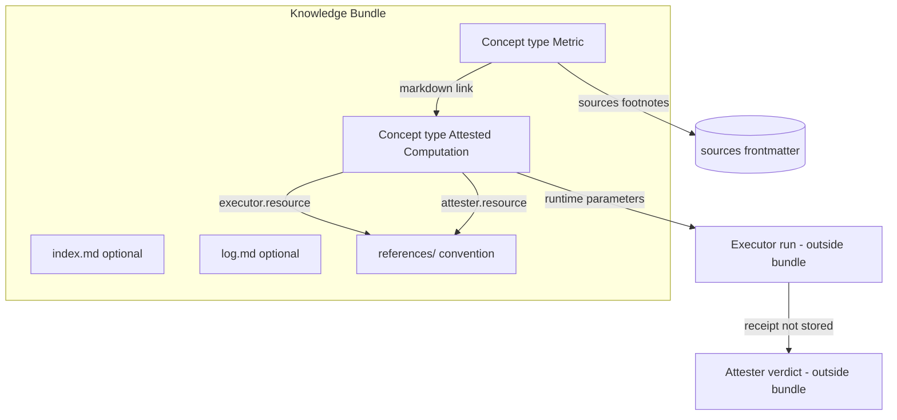

# Open Knowledge Format (OKF) 0.2

**Purpose:** Synthesized reference for AI agents implementing or consuming **OKF v0.2** knowledge corpora in ATPix. Covers bundle layout, concept frontmatter, provenance/trust/lifecycle, actors, indexes, logs, and Attested Computations. This file is itself a conformant OKF concept (`type` required; optional families present).[^okf-spec-0.2]

For the full self-contained normative text, load `docs/references/GoogleOpenKnowledgeFormat_v0.2.pdf` or the upstream [SPEC.md](https://github.com/GoogleCloudPlatform/knowledge-catalog/blob/main/okf/SPEC.md) via Progressive Disclosure.

**TL;DR:** OKF is a **directory of UTF-8 markdown files with YAML frontmatter**. No schema registry, no central authority, no required SDK. A **Knowledge Bundle** distributes **Concepts** (one `.md` file each). Only always-required frontmatter key is `type`. v0.2 adds first-class **provenance** (`sources`), **trust** (`generated` / `verified`), **lifecycle** (`status` / `stale_after`), and **Attested Computation** concepts so agents can prove a number was produced the sanctioned way.

---

## Novice Mental Model

| Everyday idea | OKF equivalent |
|---------------|----------------|
| A shippable knowledge package | **Knowledge Bundle** — directory tree of markdown |
| One topic / table / metric / playbook page | **Concept** — single `.md` with frontmatter + body |
| Stable identity of a concept | **Concept ID** — path within bundle, **without** `.md` |
| YAML header | **Frontmatter** — `---` … `---` at file start |
| “Where did this claim come from?” | **sources** + footnote labels = `sources[].id` |
| “Who wrote vs who checked it?” | **generated** vs **verified** (distinct) |
| How much to trust (advisory) | **Trust tier** derived from `verified` actors |
| Is it still current? | **status** + **stale_after** (absolute date) |
| Relationship between pages | Markdown **links** (`/bundle-relative` or relative) |
| Directory table of contents | **index.md** (reserved; progressive disclosure) |
| Changelog for a folder | **log.md** (reserved; newest first) |
| Blessed way to compute a metric | **type: Attested Computation** + executor/attester |
| Evidence from one run | **Receipt** (runtime only; **not** stored in bundle) |

**Key insight:** OKF standardizes a **small structural surface** so agent-maintained corpora stay self-describing. It does **not** define taxonomies, storage/query infrastructure, or packaging of executor/attester code. (Source: §1 Goals / Non-goals)

---

## Design Goals and Non-Goals (Source: §1)

**Goals**

1. Universal write format for people, agents, and export pipelines.
2. Inform how consumers (agents, UIs, indexes, deterministic code) read and traverse.
3. Enable exchange across systems and organizations.
4. Standardize the few frontmatter fields that make an agent-maintained corpus trustable — without prescribing a runtime.

**Non-goals**

- Fixed taxonomy of concept types.
- Prescribing storage, serving, or query infrastructure.
- Replacing domain schemas (Avro, Protobuf, OpenAPI, …) — OKF **references** them.
- Packaging/invocation standard for executor or attester code — OKF fixes the **interface**, not packaging.

**Readable / parseable / diffable / portable** without bespoke SDKs. (Source: §1 Motivation)

---

## Bundle Structure (Source: §3)

```
path/to/bundle/
  index.md                 # Optional. Progressive disclosure listing
  log.md                   # Optional. Chronological update history
  <concept>.md             # Concept at bundle root
  <subdirectory>/
    index.md
    <concept>.md
    <subdirectory>/
      ...
```

- Directory layout is **domain-independent**; producers organize as they wish. (Source: §3)
- Distribution MAY be: git repo (**recommended**), tarball/zip, or a subdirectory of a larger repo. (Source: §3)

### Reserved filenames (Source: §3.1)

| Filename | Purpose | Rule |
|----------|---------|------|
| `index.md` | Directory listing (§8) | MUST NOT be used as a concept document |
| `log.md` | Update history (§9) | MUST NOT be used as a concept document |

All other `.md` files **are** concept documents. Tags are frontmatter (`tags`), not a separate aggregation file format. (Source: §3.1)

### `references/` convention (Source: §6.3)

Optional naming convention (not required): mirror external material, run instructions, or code as first-class concepts under `references/` (e.g. `references/attesters/revenue.py`). Sources, executors, and attesters commonly point there.

---

## Concept Documents (Source: §4)

Every concept is a UTF-8 markdown file with:

1. YAML frontmatter: opening `---` alone on first line, closing `---` alone on its line.
2. Markdown **body** after frontmatter.

### Required frontmatter (Source: §4.1)

| Key | Rule |
|-----|------|
| `type` | **REQUIRED.** Non-empty short string for routing/filtering/presentation. **Not** centrally registered. Producers SHOULD pick descriptive values; consumers **MUST** tolerate unknown types (treat as generic). |

`type` alone is fully conformant. (Source: §4.1, §11)

Example type values from the spec (illustrative, not a closed enum): `BigQuery Table`, `BigQuery Dataset`, `API Endpoint`, `Metric`, `Playbook`, `Reference`, `Attested Computation`.

### Recommended frontmatter (Source: §4.1)

| Key | Purpose |
|-----|---------|
| `title` | Display name; if omitted, consumers MAY derive from filename |
| `description` | One-line summary for indexes, search, previews |
| `resource` | Canonical URI of the underlying asset; omit for pure abstractions |
| `tags` | YAML list of short strings for cross-cutting categories |

Optional families: provenance / trust / lifecycle (§5); computation fields for Attested Computation (§10).

### Extensions (Source: §4.1)

- Producers **MAY** include any additional keys.
- Consumers **SHOULD** preserve unknown keys when round-tripping.
- Consumers **MUST NOT** reject documents with unrecognized fields.

Project KB metadata keys such as `kb-title`, `source-reference`, `spec-version` are valid **extensions** under this rule.

### Body conventions (Source: §4.2)

- No required body sections.
- Producers **SHOULD** favor structural markdown (headings, lists, tables, fences) over freeform prose.
- Conventional headings when applicable:

| Heading | Purpose |
|---------|---------|
| `# Schema` | Columns/fields of an asset |
| `# Examples` | Concrete usage, often fenced code |
| `# Computation` | Sanctioned computation for Attested Computation (§10) |

Per-claim attribution uses **markdown footnotes** keyed to `sources[].id`, not a body citations list. (Source: §4.2, §5.1)

---

## Provenance, Trust, and Lifecycle (Source: §5)

All families optional. Absence is meaningful (e.g. unverified ≠ rejected). (Source: §5, §11)

### Provenance: `sources` (Source: §5.1)

```yaml
sources:
  - id: ga4-schema
    resource: https://developers.google.com/analytics/bigquery/export-schema
    title: GA4 BigQuery Export schema
    author: team:ga4-docs
    usage_count: 5000
    last_modified: 2026-05-30
usage_window: { from: 2026-06-01, to: 2026-06-30 }
```

| Field | Requirement | Notes |
|-------|-------------|--------|
| `resource` | **REQUIRED** within each entry | Absolute URL, bundle-relative `/…` path, path into `references/`, **or** a non-path **scope descriptor** (e.g. “all queries in project X”) |
| `id` | Optional; **SHOULD** when body cites source | Stable join key for footnotes |
| `title` | Optional | Human label |
| `author` | Optional credibility signal | Actor-style identity (§7) |
| `usage_count` | Optional | Exercises over `usage_window` (liveness, not a score) |
| `last_modified` | Optional | Source recency as `YYYY-MM-DD` (≠ `generated.at`) |
| `usage_window` | Sibling of `sources` list, or per-entry override | `{ from, to }` dates framing `usage_count` |

**Credibility:** OKF records **signals**, not a stored score or verdict. Consumers infer trust from signals. (Source: §5.1)

**Lineage:** Through markdown links and `resource` pointing at other concepts — no dedicated `derived_from` in v0.2. Deeper external/data lineage is out of scope. (Source: §5.1)

**Per-claim attribution:**

```markdown
The `events_` table is sharded daily as `events_YYYYMMDD`.[^ga4-schema]

[^ga4-schema]: GA4 BigQuery Export schema
```

Footnote **label** = `sources[].id`. Resolve attribution via the matching entry, not footnote prose. Prefer stable `id` over positional `sources[0]` (agents reorder lists). (Source: §5.1)

### Trust: `generated` and `verified` (Source: §5.2)

Kept distinct: who wrote ≠ who confirmed.

```yaml
generated: { by: reference_agent/gemini-2.5-pro, at: 2026-06-20T22:53:05Z }

verified:
  - { by: human:ahormati, at: 2026-06-25T09:00:00Z }
  - { by: process:finance-nightly, at: 2026-06-26T02:00:00Z }

# Bare mapping MUST be treated as a one-element list:
verified: { by: human:ahormati, at: 2026-06-25T09:00:00Z }
```

| Field | Rule |
|-------|------|
| `generated.by` | **REQUIRED** within `generated`. Actor (§7) |
| `generated.at` | ISO 8601 datetime of last meaningful content change |
| `verified` | List of `{ by, at }` events; bare mapping ≡ one-element list |
| Independence | Content can change without re-verify; can re-verify without regenerate |

### Trust tiers (Source: §5.3) — **derived by consumer**, not stored

| Condition | Tier |
|-----------|------|
| No `verified` key | `unverified` |
| `verified` only by non-`human:` actors | `machine-confirmed` |
| Any `verified` by `human:<id>` | `human-reviewed` |

Advisory only — **not** access control. Missing trust frontmatter is still consumable; consumers **MUST NOT** reject. (Source: §5.3, §11)

### Lifecycle: `status` (Source: §5.4)

```yaml
status: stable   # draft | stable | deprecated
```

| Value | Meaning |
|-------|---------|
| `draft` | Not yet reviewed; possibly incomplete |
| `stable` | Ready for consumption |
| `deprecated` | Kept for links/history; no longer current |

**Absent `status` ⇒ `stable`.** (Source: §5.4)

### Lifecycle: `stale_after` (Source: §5.5)

```yaml
stale_after: 2026-09-23   # YYYY-MM-DD absolute
```

Concept is **stale** when `today >= stale_after`. Absolute date only (not relative TTL) so staleness is a plain date compare. (Source: §5.5)

---

## Cross-Linking and Paths (Source: §6)

### Links (Source: §6.1)

| Form | Example | Notes |
|------|---------|--------|
| Absolute (bundle-relative) | `[customers](/tables/customers.md)` | **Recommended**; stable when files move within a subdir |
| Relative | `[neighbor](./other.md)` | Standard markdown relative path |

- Link asserts a relationship; **kind** (joins-with, depends-on, …) is **prose**, not typed link metadata.
- Graph consumers typically treat links as directed **untyped** edges.
- Consumers **MUST** tolerate broken links (may mean not-yet-written knowledge). (Source: §6.1)

### Path-valued fields (Source: §6.2)

Apply to: `resource`, `sources[].resource` (unless scope descriptor), `computation`, `executor.resource`, `attester.resource`.

Each accepts:

1. Absolute URL (`https://…`)
2. Bundle-relative path starting with `/`
3. Relative path (`../computations/revenue.md`)

---

## Actor Convention (Source: §7)

| Pattern | Use |
|---------|-----|
| `<producer>/<version>` | Agents/tools, e.g. `reference_agent/gemini-2.5-pro` |
| `human:<id>` | Person, e.g. `human:ahormati` |
| `process:<id>` | Automated process, e.g. `process:finance-nightly` |

Trust classification keys off the `human:` prefix — producers **MUST** use it for hand-authored or human-confirmed content. (Source: §7)

---

## Index Files (Source: §8)

- `index.md` MAY appear in any directory (including bundle root).
- **No frontmatter**, except bundle-root `index.md` MAY have `okf_version` only (§12).
- Body: sections under headings; bullet entries:

```markdown
# Section / Group Heading

* [Title 1](relative-url-1) - short description of item 1
* [Subdirectory](subdir/) - short description of the subdirectory
```

- Entries SHOULD include the linked concept’s `description`.
- Producers MAY auto-generate; consumers MAY synthesize when missing. (Source: §8)

---

## Log Files (Source: §9)

- `log.md` MAY appear at any hierarchy level for that scope’s history.
- Flat list, **newest first**, date headings **MUST** be ISO 8601 `YYYY-MM-DD`:

```markdown
# Directory Update Log

## 2026-05-22
* **Update**: Added … [Customer Metrics](/tables/customer-metrics.md).
* **Creation**: Established …

## 2026-05-15
* **Initialization**: Created foundational directory structure.
```

Leading bold words (`**Update**`, `**Creation**`, `**Deprecation**`) are convention, not required. (Source: §9)

---

## Attested Computations (Source: §10)

**Problem:** Provenance answers “where did this claim come from?”; attestation answers “was this number produced the way we said it must be?” OKF records the computation and check interface; it does **not** execute anything. (Source: §10)

### Standalone concept (Source: §10.1)

- `type: Attested Computation` is its **own** concept.
- Metrics/tables **link** to it with normal markdown links.
- Motivations: runtime defines parameter semantics; one computation many consumers; trust/attester state is **per computation**.

### Contract fields (Source: §10.2)

In addition to §5 families:

| Field | Requirement | Role |
|-------|-------------|------|
| `runtime` | **REQUIRED** for this type | How to run / how parameters bind. Examples: `bigquery`, `postgres`, `dbt`, `python`, `Looker` |
| `parameters` | List of `{ name, type, required }` | Only holes the agent may fill |
| `computation` | Optional path (§6.2) | External computation file; if absent → body `# Computation` fence |
| `executor` | `resource` + `receipt` | Run instructions/code; `receipt` = field names a run must return |
| `attester` | `resource` | Deterministic (no-LLM) code: receipt → verdict; consumer-side |

Packaging behind `resource` (Skill, script, container) is out of scope. (Source: §10.2, §1)

### Minimal Attested Computation shape (Source: §10.2–10.3)

Frontmatter (contract):

```yaml
type: Attested Computation
title: Revenue for fiscal year
description: Recognized revenue for a fiscal year, per Finance's definition.
status: stable
runtime: bigquery
parameters:
  - { name: year, type: integer, required: true }
executor:
  resource: references/skills/run-on-bq.md
  receipt: [job_id, executed_sql, result]
attester:
  resource: references/attesters/revenue.py
generated: { by: reference_agent/gemini-2.5-pro, at: 2026-06-20T22:53:05Z }
verified: { by: human:ahormati, at: 2026-06-25T09:00:00Z }
stale_after: 2026-09-23
sources:
  - id: rev-policy
    resource: https://wiki.acme/finance/revenue-recognition
    title: Revenue recognition policy
```

Body (inline form under conventional heading):

- Heading: `# Computation`
- One fenced code block holding the sanctioned SQL/dbt/python (agent must not edit this text)
- Example body SQL: `SELECT SUM(amount) AS revenue FROM finance.recognized_revenue WHERE fiscal_year = @year`

**Computation delivery (Source: §10.3)**

1. **Inline:** single fenced block under `# Computation`.
2. **File:** set `computation:` path; omit body fence.

**Hard agent rule:** Agent MAY only supply values for declared `parameters`; it **MUST NOT** author or edit the computation. Consumer binds parameters; attester re-derives the same binding and compares expanded artifact in the receipt (`executed_sql` / `compiled_sql`). (Source: §10.3)

### Consumer flow — informative (Source: §10.5)

Runtime artifacts (**receipt**, verdict) are **not** stored in the bundle.

1. Discover `type: Attested Computation` (or follow links).
2. Load contract + computation (body or `computation` file).
3. Parameterize with declared parameters only.
4. Execute via executor → receipt shaped by `executor.receipt`.
5. Attest with attester (provenance of computation + fidelity of displayed value).
6. Gate: refuse failing attestation; warn/refuse when `today >= stale_after`; surface verdict on success.

### Verification vs attestation (Source: §10.6)

| Mechanism | Confirms | When | Stored in bundle? |
|-----------|----------|------|-------------------|
| `verified` | Definition matches policy | Doc-level, slow | **Yes** |
| Attestation | One run used the sanctioned computation | Per-call, runtime | **No** |

Both needed: stale definition can still attest; fresh verification still requires per-run attestation. (Source: §10.6)

---

## Conformance Checklist (Source: §11)

A bundle is **conformant OKF v0.2** if:

1. Every non-reserved `.md` file has a **parseable YAML frontmatter** block.
2. Every frontmatter has a **non-empty `type`**.
3. Every present reserved file (`index.md`, `log.md`) follows §8 / §9 structure.

When optional families are present, producers **SHOULD** follow §5–§10. Consumers:

| Rule | Strength |
|------|----------|
| Treat bare `verified` mapping as one-element list | **MUST** |
| Not reject for missing optional families | **MUST NOT** reject |
| Derive trust tiers and staleness only from specified fields | **SHOULD** |
| Surface, not silently drop, failing attestation | **SHOULD** |

Consumers **MUST NOT** reject a bundle because of:

- Missing optional frontmatter
- Unknown `type` values
- Unknown additional frontmatter keys
- Broken cross-links
- Missing `index.md` files

---

## Versioning (Source: §12)

- Spec version **0.2**; revisions are `<major>.<minor>`.
- **Minor:** backward-compatible additions (optional fields, conventional headings).
- **Major:** breaking (rename required fields, change reserved filenames).
- Bundles MAY declare target with root `index.md` frontmatter only:

```yaml
---
okf_version: "0.2"
---
```

- Consumers that do not understand the declared version **SHOULD** attempt best-effort consumption, not refuse.

### Deferred to future revisions (Source: §12)

Full receipt/verdict wire protocol, attester ABI/sandboxing, attestation caching, semantic-layer templates (Looker/dbt model-binding equality).

---

## Changes from v0.1 (Source: §13)

### Breaking (with v0.2 consumer fallbacks)

| v0.1 | v0.2 | Consumer fallback |
|------|------|-------------------|
| `timestamp` | `generated.at` (inside `generated: { by, at }`) | MAY use legacy `timestamp` if `generated` absent |
| Body `# Citations` list | Frontmatter `sources` | SHOULD read `sources`; MAY still parse legacy `# Citations` |

### Additive

- `sources` + credibility signals + `usage_window`
- `generated`, `verified`, `status`, `stale_after`
- Type `Attested Computation` + `runtime`, `parameters`, `computation`, `executor`, `attester`
- Body heading `# Computation`
- Actor convention (§7)

Everything else (bundle structure, reserved names, required `type`, recommended title/description/resource/tags, linking, index/log, permissive conformance) carried forward. (Source: §13.2)

---

## Architecture: Bundle Graph



---

## Agent Implementation Rules (ATPix)

1. **Write conformant concepts:** every concept `.md` gets YAML frontmatter with non-empty `type`. Never name concepts `index.md` or `log.md`.
2. **Prefer structural bodies** and bundle-relative links starting with `/` for stable graphs.
3. **Record provenance** with `sources` + footnote `id`s when claims derive from materials; do not invent a citations body list for new content.
4. **Split write vs confirm:** set `generated` when content changes; append `verified` only when something actually checked against sources/resource.
5. **Use actor prefixes correctly** so trust tiers work (`human:` for people).
6. **Default lifecycle:** omit `status` only when stable is intended; set `stale_after` as absolute `YYYY-MM-DD` for facts that expire.
7. **Never reject** optional-field absence, unknown types, extra keys, or broken links when consuming.
8. **Normalize `verified`:** bare mapping → one-element list before processing.
9. **Attested numbers:** put SQL/dbt/python in `Attested Computation` concepts; narrative Metrics **link** to them; agents only fill `parameters`; never let the agent rewrite the computation text.
10. **Do not persist receipts** in the bundle; attestation is per-run evidence outside OKF storage.
11. **v0.1 interop:** if reading old docs, map `timestamp` → `generated.at` and `# Citations` → `sources` when possible.
12. **This KB file:** uses OKF `type: Reference` plus project extension keys (`kb-title`, `source-reference`, …) — valid under §4.1 extensions.

### Success criteria for an OKF writer/reader

| Check | Pass condition |
|-------|----------------|
| Concept parse | Frontmatter YAML parses; `type` non-empty |
| Reserved files | `index.md` / `log.md` never treated as concepts; structure matches §8/§9 if present |
| Links | Broken targets do not fail the bundle |
| Trust | Tiers computed only from `verified` + actor prefixes |
| Staleness | `today >= stale_after` when date set |
| Attestation | Parameters-only binding; attester compares receipt to sanctioned computation |
| Conformance | Soft guidance only beyond §11 hard rules |

---

## Worked Pattern: Narrative Metric + Two Computations (Source: Appendix A)

```
bundles/finance/
  metrics/income-statement.md     # type: Metric — narrates, links both
  computations/revenue.md         # type: Attested Computation (bigquery)
  computations/profit.md          # type: Attested Computation (dbt)
  references/skills/…
  references/attesters/…
```

- Trust and staleness live **on each computation**, not only on the narrative.
- One figure can be human-reviewed and fresh while another is process-verified and past `stale_after`.
- Co-location under `computations/` is a directory choice, not a frontmatter requirement. (Source: §10.4, Appendix A)

---

## Related Resources

| Resource | Role |
|----------|------|
| `docs/references/GoogleOpenKnowledgeFormat_v0.2.pdf` | Local snapshot of SPEC |
| [OKF SPEC.md](https://github.com/GoogleCloudPlatform/knowledge-catalog/blob/main/okf/SPEC.md) | Upstream normative source |
| [.agents/kb/ocfl.md](./ocfl.md) | Object storage layout (orthogonal; package OKF bundles *inside* OCFL if preserving corpora) |
| [.agents/kb/agent-skills-1.0.md](./agent-skills-1.0.md) | Agent Skills packaging (may back `executor.resource`) |

---

## Quick Decision Table

| Question | Answer (OKF v0.2) |
|----------|-------------------|
| What’s the unit of knowledge? | One concept = one `.md` file |
| What’s always required? | Non-empty frontmatter `type` |
| Can I add custom frontmatter? | Yes; consumers must not reject |
| How do I cite a claim? | `sources` + footnote label = `sources[].id` |
| How is trust stored? | Events in `verified`; tier is **derived** |
| Default status? | `stable` if omitted |
| How do paths work? | URL, `/bundle-root…`, or relative |
| Reserved names? | `index.md`, `log.md` only |
| Where is computation defined? | `Attested Computation` body or `computation` path |
| May agents invent SQL? | **MUST NOT** — parameters only |
| Are receipts in git? | **No** — runtime only |
| v0.1 `timestamp`? | Prefer `generated.at`; MAY fall back |

[^okf-spec-0.2]: Open Knowledge Format (OKF) Version 0.2 — local snapshot
[^okf-spec-github]: OKF SPEC.md on GoogleCloudPlatform/knowledge-catalog
