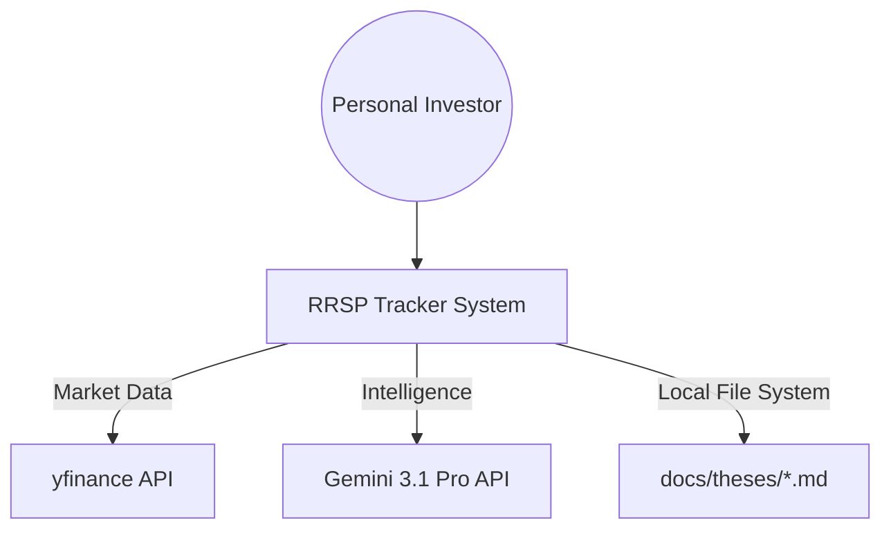
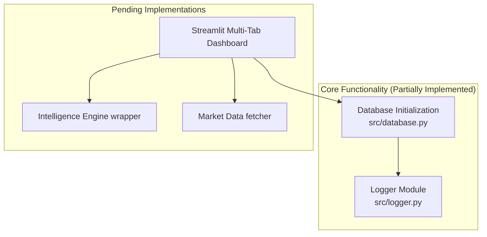
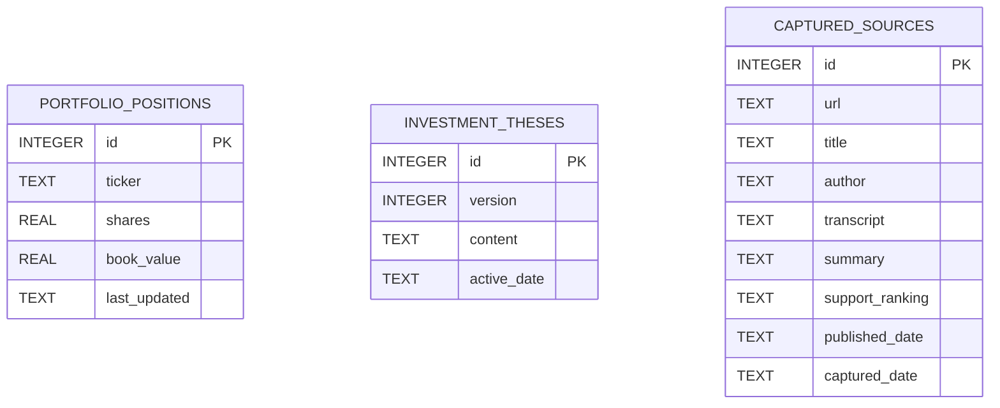
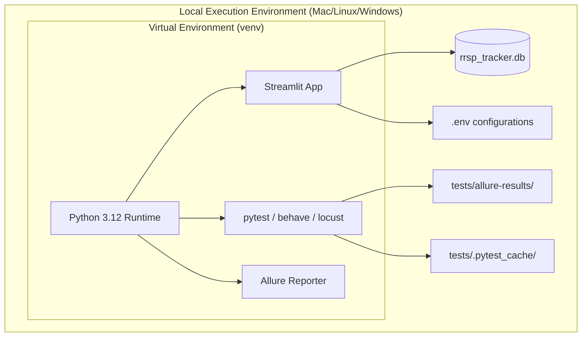
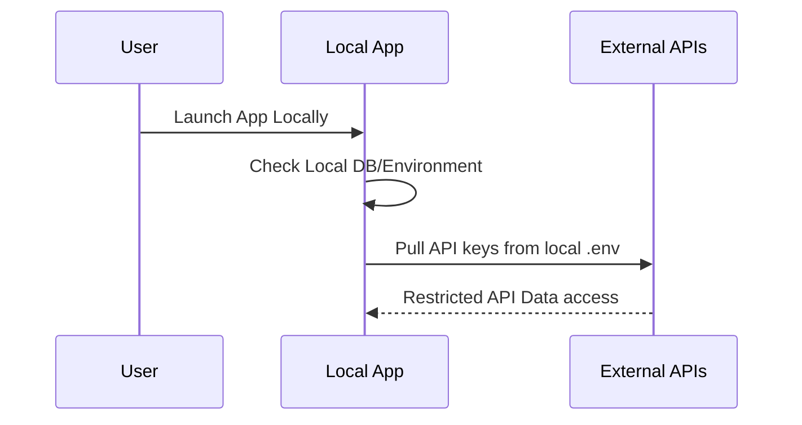

# System Architecture Document

## 1. Introduction
### 1.1 Purpose
The purpose of this document is to provide a comprehensive, top-level architectural overview of the RRSP Systemic Resilience Tracker. It complies with ISO 42010 to address stakeholder concerns through formal architectural viewpoints.

### 1.2 Scope
This document covers the local-first execution environment, data persistence strategy, AI intelligence integration, and the currently implemented system components of the RRSP Tracker portfolio management application.

### 1.3 References
- **PRD:** [Product Requirements Document](./prd.md)
- **SRS:** [Software Requirements Specification](./srs.md)
- **Implementation Plan:** [Project Plan](./plan.md)
- **ADRs:** [Architecture Decision Records](./architecture/)

### 1.4 Architectural Principles
- **Antigravity Principle:** Minimize dependencies, maximize simplicity.
- **Local-First Executions:** Operate securely and cost-effectively from the host machine without relying on external cloud databases.
- **Traceability:** Fully traceable implementations and test configurations.
- **Observability:** Explicit console feedback for rate-limits and noisy debug logging.

## 2. Context & Stakeholder Viewpoint (ISO 42010)
*Addresses: Who interacts with the system, external dependencies, and what the key stakeholder concerns are.*

### 2.1 Stakeholders & Concerns
- **Personal Investor (User):** Data sovereignty (local-first), low latency (non-blocking UI), and accurate automated intel processing.
- **Developer:** Minimal friction tooling, robust observability (`logger`), and clear test artifact boundaries.

### 2.2 Context Diagram

## 3. Functional/Logical Viewpoint (ISO 42010)
*Addresses: How the system is subdivided into modules, their responsibilities, and how they interact logically.*

### 3.1 Logical Architecture

### 3.2 Frontend Architecture (Targeted)
- **Framework & Technologies:** Streamlit (Multi-tab structure).
- **Key Design Patterns:** Application caching (`@st.cache_data`), reactive fragments (`@st.fragment`).

### 3.3 Backend Architecture (Current Base)
- **Framework & Technologies:** Pure Python 3.10+ execution.
- **System Components:** `logger.py` for global debug tracing, `database.py` for automated schema management.

## 4. Information/Data Viewpoint (ISO 42010)
*Addresses: Data structures, database systems, permanence, caching, and data flow.*

### 4.1 Data Architecture

### 4.2 Database Decisions
- **Primary Database:** SQLite (`rrsp_tracker.db`), ensuring absolute local sovereignty and a zero-scale cost footprint.
- **Schema Management:** Python `sqlite3` driver providing idempotent `IF NOT EXISTS` DDL scripts on startup.

## 5. Deployment/Physical Viewpoint (ISO 42010)
*Addresses: How the logical components are mapped onto physical hardware, cloud instances, or container networks.*

### 5.1 Infrastructure Architecture

### 5.2 Build & Execution Pipeline
- **Execution:** Locally installed Python virtual environments (`venv/bin/activate`).
- **Test Artifact Isolation:** Explicit `.gitignore` and `pytest.ini` boundaries routing artifacts solely to `tests/`.

## 6. Security Viewpoint (ISO 42010)
*Addresses: Threat vectors, authentication boundaries, and data protection mechanisms.*

### 6.1 Authentication Flow

### 6.2 Security Measures
- **Network Boundaries:** Application exclusively bound to localhost (`127.0.0.1`), entirely bypassing traditional cloud vulnerabilities.
- **Key Management:** External API keys (Gemini) injected safely via `.env`.

## 7. Performance & Concurrency Viewpoint (ISO 42010)
*Addresses: Scalability, error handling, rate limiting, and system observation mechanisms.*

### 7.1 Scalability Constraints
- **Known Bottlenecks:** External API rate limits.
- **Mitigation:** Uniqueness checks on URLs before making AI fetch requests. Strict UI notification wrappers capturing HTTP 429 errors from the Intelligence Engine.

### 7.2 Observability & Monitoring
- **Logging Subsystems:** Command-line invocation (`python -m src.database --logger.level=debug`) dynamically alters tracking logic from `INFO` to `DEBUG`. Includes exception stack traces (`exc_info=True`) natively.

## 8. Technology Decisions Summary
| Layer | Technology | Rationale |
|-------|------------|-----------|
| **Frontend** | Streamlit | [ADR-001] Fast prototyping of reactive dashboards. |
| **Database** | SQLite | [ADR-002] Serverless, local-first secure storage. |
| **AI Engine** | Gemini 3.1 Pro | [ADR-003] Powerful context window + explicit integration. |
| **Execution** | Local-First | [ADR-004] Zero cloud hosting costs, 100% data privacy. |
| **Unit/UI Testing**| pytest & AppTest | [ADR-005] Native Streamlit rendering verification. |
| **Integration Testing**| pytest-vcr | [ADR-006] Mocking and stubbing external HTTP requests. |
| **Load Testing** | Locust | [ADR-007] Python-native concurrency simulation. |
| **Reporting** | Allure | [ADR-008] Aggregated JSON/HTML visualization of pass/fail coverage. |
